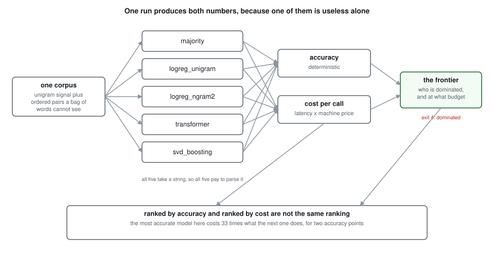
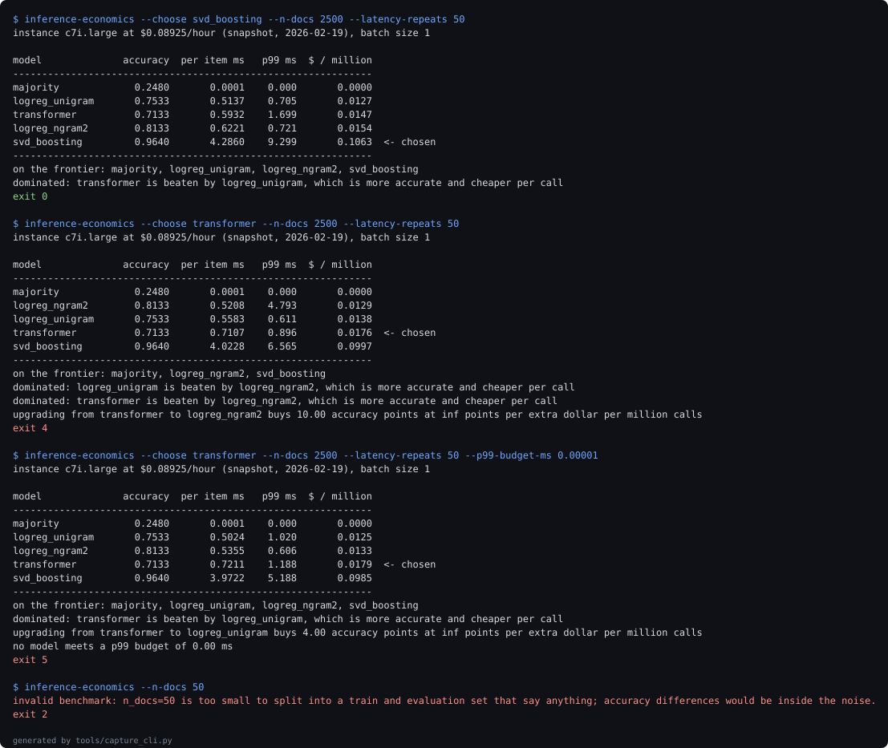

# inference-economics-bench

An accuracy number is not a comparison until a cost sits beside it.

Five models on one text classification task, measured for accuracy and for what a
prediction costs to serve, on the same machine, in the same run. The two measurements rank
the models differently, and that difference is large enough to invert a deployment
decision.



## The two tables

Here are the models ranked the way a model comparison usually ends:

| model | accuracy |
| --- | --- |
| svd_boosting | 0.9769 |
| transformer | 0.9542 |
| logreg_ngram2 | 0.9028 |
| logreg_unigram | 0.8850 |
| majority | 0.2433 |

Here are the same five, on a c7i.large at $0.08925 an hour, serving one request at a time:

| model | accuracy | p99 ms | $ / million |
| --- | --- | --- | --- |
| majority | 0.2433 | 0.000 | 0.0000 |
| logreg_unigram | 0.8850 | 0.733 | 0.0092 |
| logreg_ngram2 | 0.9028 | 0.788 | 0.0136 |
| transformer | 0.9542 | 2.603 | 0.0154 |
| svd_boosting | 0.9769 | 30.552 | 0.5177 |

The first table says the gap between the best and the cheapest useful model is 9.19
accuracy points. The second says it is 56.2 times the price per call.

Note which model is on top, too. Gradient boosting on reduced TF-IDF beats the transformer
by 2.27 accuracy points while costing 33.6 times as much per call, in a 73 MB artifact
against 663 KB. I expected the neural model to be the expensive one. It is the middle of
the range.

## Nothing here is dominated, which is the uncomfortable part

No model in that table is beaten on both axes at once, so none of them can be ruled out. A
model that is both less accurate and more expensive than another has no budget at which it
is correct, and that would be an easy thing to say. Instead every one of these is the right
answer somewhere, and which one depends entirely on a number the accuracy table does not
contain.

Sweeping that number:

| budget $/million | most accurate model that fits |
| --- | --- |
| 0.005 | majority |
| 0.01 | logreg_unigram |
| 0.02 | transformer |
| 0.05 | transformer |
| 0.2 | transformer |
| 1 | svd_boosting |

4 different models win across six budgets. Adding a tail latency limit as a second
constraint, across 30 budget and latency pairs, 22 of them select a different model
depending on which constraint you read first.

What each step up the frontier buys:

| from | to | accuracy points per extra dollar per million |
| --- | --- | --- |
| majority | logreg_unigram | 6975.0 |
| logreg_unigram | logreg_ngram2 | 404.6 |
| logreg_ngram2 | transformer | 2855.6 |
| transformer | svd_boosting | 4.5 |

The first step buys 6975.0 accuracy points per extra dollar. The last is 4.5 points, a
ratio of 1543 between the best and the worst upgrade on the same frontier. Every one of
these steps looks like a small accuracy improvement in a results table.

## Batching changes the magnitude, not the ranking

Most inference is not served one request at a time. Queueing requests and running them
together divides the fixed per call costs by the batch size, and the models do not benefit
equally, because they do not have equal fixed costs to amortise.

| model | batch 1 | batch 8 | batch 64 |
| --- | --- | --- | --- |
| majority | 0.0000 | 0.0000 | 0.0000 |
| logreg_unigram | 0.0117 | 0.0021 | 0.0008 |
| logreg_ngram2 | 0.0126 | 0.0028 | 0.0013 |
| transformer | 0.0215 | 0.0095 | 0.0048 |
| svd_boosting | 0.7054 | 0.0816 | 0.0126 |

The batch 1 column does not match the cost table above it, and should not: the two come
from separate runs, and gradient boosting is priced at 0.5177 there against 0.7054 here.
That spread is the measurement noise this section is about, and it is larger between runs
than within one. It is left visible rather than reconciled, because quietly copying one
run's number into the other table would hide exactly the thing being reported.

Gradient boosting gets 55.9 times cheaper when batched, against only 4.5 times for the
transformer. The premium for the most accurate model falls from 60.0x at batch 1 to 16.1x
at batch 64.

The ordering itself holds: exactly 0 pairs reverse between batch sizes.

That conclusion took three runs to get right, and the first two were wrong in opposite
directions. The first said the ordering never changed. The second said it did. Both were
correct, because the two models that swapped places are closer together than this harness
can resolve. The experiment now times each model five separate times, publishes the
spread, and treats models within 1.17 of each other as tied rather than ranked. What looks
like a reordering at batch 64 is a tie being resolved, not a reversal, and those are
different claims.

## When does the expensive model actually pay?

The corpus mixes two kinds of signal: word frequencies that any linear model finds, and
ordered word pairs that invert the class, the way "not recommended" inverts
"recommended". A unigram model cannot represent the second kind at all. The share of
documents carrying it is a knob.

| phrase rate | unigram | bigram | transformer | gap to best |
| --- | --- | --- | --- | --- |
| 0.0 | 0.9779 | 0.9779 | 0.9583 | 0.00 |
| 0.2 | 0.8638 | 0.8754 | 0.9471 | 10.88 |
| 0.4 | 0.8350 | 0.8788 | 0.9417 | 13.75 |
| 0.6 | 0.9092 | 0.9608 | 0.9504 | 6.83 |
| 0.8 | 0.9479 | 0.9717 | 0.9517 | 2.88 |

The first row is the control, and it holds exactly: with no order dependent signal, the
bigram model gains 0.00 accuracy points over the unigram one. There is nothing to find and
it finds nothing. If that row had shown a gain, the generator would have been leaking
something it does not claim to contain, and every conclusion below it would have been
drawn from the leak.

That row also contains the sharpest result here. At phrase rate zero the unigram reaches
0.9779 while the transformer manages 0.9583. The expensive model is less accurate than
logistic regression on word counts, and costs more to run.

The gap the expensive model has to justify ranges from as little as 0.00 points to as much
as 13.75 across the sweep. It peaks in the middle and nearly closes at the top, because by
phrase rate 0.8 a bigram vectoriser has captured most of what there is to capture: it
gains 2.38 points over unigrams there, for a cost difference that rounds to nothing.

The practical form of that: before reaching for an expensive model, measure how much of
your signal is order dependent. One extra argument to a vectoriser is the control
experiment, and it is an afternoon.

## Using it

```bash
make verify     # tests, lint, reproducible accuracies, figure check
make bench      # rerun the four experiments and rewrite docs/experiments
inference-economics --choose transformer --p99-budget-ms 2.0
inference-economics --choose svd_boosting --json
```

| code | meaning |
| --- | --- |
| 0 | the chosen model is on the frontier |
| 1 | a cheaper model is within a point of it, or it misses the latency budget |
| 2 | benchmark configuration rejected |
| 3 | internal error |
| 4 | the chosen model is dominated: another is both more accurate and cheaper |
| 5 | no model meets the latency budget at any price |



That image is generated from stdout captured at run time, and
`docs/evidence-manifest.json` records each command with the exit code it actually
returned. It is not byte reproducible, because it contains real timings; the exit codes
are, and they are what the manifest exists to let you check. The run in it uses a smaller
corpus than the tables above, which is why the transformer is dominated there: undertrained
on 2,500 documents it is beaten on accuracy and on cost at once.

Exit 4 is the one worth having. A dominated model has no budget at which it is the right
answer, and no accuracy table can tell you that.

## Where the prices come from

Costs are computed from a committed price snapshot, dated and in version control, so every
figure here is reproducible and a reader can see how stale it is. A second path queries the
AWS Price List API through boto3 for the question an operator actually has, which is what
this costs now. That path is covered by tests that stub the client rather than calling AWS,
and it falls back to the snapshot rather than failing a benchmark over a reporting detail.
The returned price records which source it came from and every table prints it.

The cost model is compute only: no storage, no egress, no idle capacity, no autoscaling
inefficiency, no engineer time. Every one of those makes the expensive model relatively
worse, so the gaps here are lower bounds.

## Verification

Accuracy is deterministic and latency is not, so they are checked differently.
`tools/check_reproducible.py` re-fits the cheap models on every verify and asserts their
recorded accuracies still hold to the digit. Everything timed is read from the recorded run
in `docs/experiments/` and regenerated deliberately by `make bench`, because a check that
re-measures a non-deterministic quantity and demands it match fails at random, and a check
that fails at random is one everybody learns to ignore.

Both kinds are registered in `docs/metrics.json` with anchor phrases and checked in both
directions: every metric must appear in the prose through its anchor, and every decimal in
the prose must correspond to a metric. The suite is 71 tests at 100 percent line coverage.

## What this cannot measure

The task is synthetic and the transformer is trained from scratch, because no pretrained
weights could be downloaded in the environment this was built in. A fine tuned DistilBERT
would be more accurate and considerably more expensive, which moves every number here
without changing the argument.
[ADR-005](docs/adr/ADR-005-what-this-cannot-measure.md) is the full list.

## How this was built

I built this with AI assistance (Claude), working through the design, the experiments and
the writing in dialogue. The decisions, including the experiment that was renamed when it
refuted its own title and the finding that was nearly published from noise, are recorded in
`docs/adr/` as they happened. I am stating this plainly because a repository about honest
measurement should not be coy about its own provenance.

## Layout

```
src/inference_economics/  corpus, models, latency, pricing, economics, report, cli
experiments/              the four experiments, writing JSON to docs/experiments/
tests/                    71 tests
tools/                    metric collection, the number checker, the reproducibility check
docs/adr/                 five decision records
```
